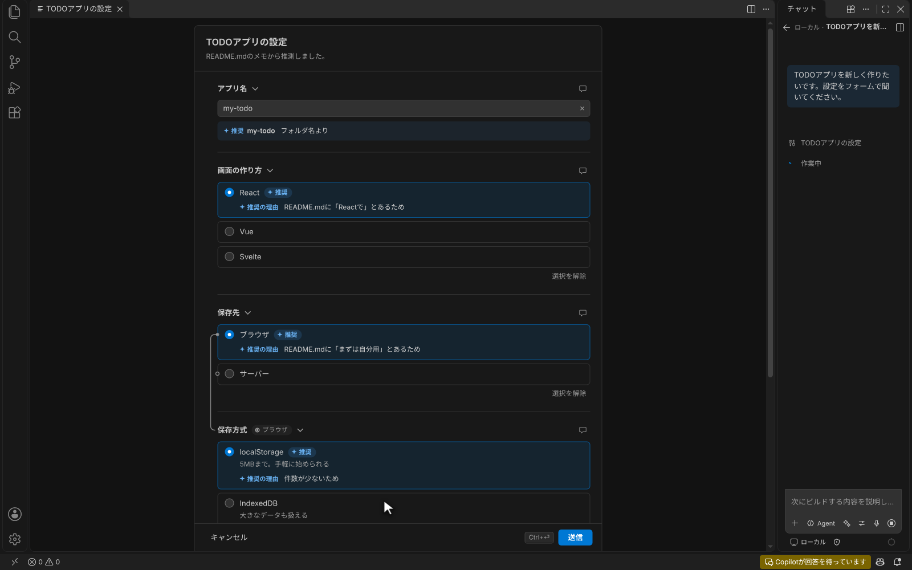
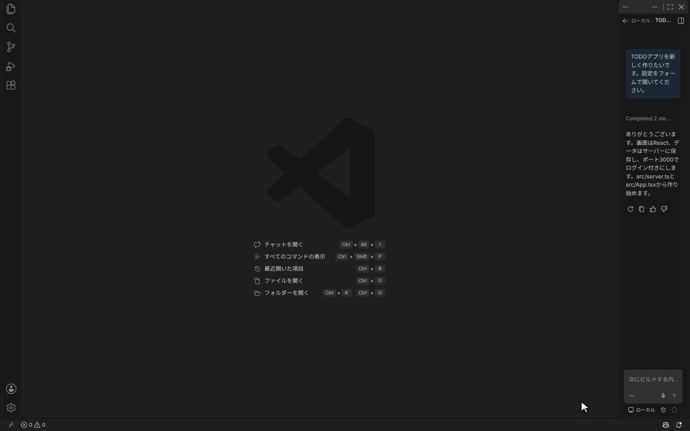

<h1 align="center">Ask User Form</h1>

<p align="center">
  GitHub Copilotが、チャットの横に出るフォームであなたに質問できるようにするVS Codeの拡張機能
</p>

<p align="center">
  <a href="https://github.com/kkun84/vscode-ask-user-form/actions/workflows/ci.yml"></a>
  <a href="LICENSE"></a>
  
  
</p>

<p align="center">
  
</p>

Copilotは、仕事を進める途中で利用者に確認したいことがよくあります。文章でやり取りすると、1つ答えるたびに次の質問が来て、何度も往復することになります。「保存先はサーバーで」と答えると「ではポート番号は？」と続く、という具合です。

Ask User Formを入れると、Copilotは聞きたいことを**1つのフォームにまとめて**聞けます。続きの質問も、**選んだ答えに応じて**同じフォームの中に現れます。各質問には、Copilotが勧める答えとその理由が最初から入っています。利用者は違うところだけを直し、ボタンを1回押せば答え終わり、Copilotは同じ作業の流れのまま、受け取った値で続きを進めます。

## 目次

- [特徴](#特徴)
- [スクリーンショット](#スクリーンショット)
- [動作環境](#動作環境)
- [インストール](#インストール)
- [使い方](#使い方)
- [フォームの設計図](#フォームの設計図)
- [しくみ](#しくみ)
- [よくある質問](#よくある質問)
- [開発](#開発)
- [ライセンス](#ライセンス)

## 特徴

- **往復せずに1回で聞き切る**: 聞きたいことを1つのフォームにまとめて聞けます。「送信」を押すと、回答がそのままツールの結果としてCopilotに届きます。チャットに打ち直す必要はありません。
- **選んだ答えに応じて続きを聞ける**: 「保存先がサーバーならポート番号も聞く」のように、選んだ選択肢に応じて現れる質問を置けます。利用者には選んだ選択肢に関係する質問だけが見え、Copilotにも関係する値だけが届きます。
- **推奨と理由が分かるフォーム**: Copilotが勧める選択肢には「推奨」の印と理由が付きます。どの選択肢にも、それが何か、選ぶとどうなるかの説明が付くので、選択肢の意味をCopilotに聞き直さずに済みます。推奨から変えた項目は、Copilotにも伝わります。
- **推奨のない質問も聞ける**: Copilotが根拠を持って勧められない質問は、何も選ばれていない状態で出ます。推奨のない単一選択と数値の質問は、答えるか、コメントを書くまで送信できません。
- **詳しい説明は畳める**: 選択肢の詳しい説明と推奨の理由は、最初から開いています。読み終えたら、見出しの右の「詳細」で畳めます。選んだり、ほかの質問へ移ったりしても、勝手に開閉しません。
- **決める前に結果が分かる**: 選んだ値から計算される値を、フォームの中で示せます。たとえばメモの最大文字数を上げると、保存できる件数がどれだけ減るかがその場で分かります。
- **答えない質問はコメントだけで返せる**: 単一選択は見出しの右の「選択を解除」で、数値は入力欄を空にして値を外し、「他の要件を先に決める。」「この質問の意味がわからない。説明が足りない。」のようなコメントを書けば、値を答えずに送信できます。推奨のない質問は、何も選ばずにコメントを書くだけで送れます。Copilotは値を決めつけず、コメントに従います。必要になれば、その質問をフォームで聞き直します。
- **質問ごとにコメントを添えられる**: 見出しの右端の吹き出しのアイコンを押すと、その質問について伝えたいことを書けます。値だけ、コメントだけ、両方のどれでも送れます。よく使う文は定型文のボタンで入れられます。既定の定型文は「他の要件を先に決める。」「この質問の意味がわからない。説明が足りない。」「インターネットで調査した上でもう一度検討しよう。」の3つで、設定`askUserForm.commentPresets`で変えられます。
- **選択肢にない答えも1回で伝わる**: 「補足を書く」を開くと、選択肢にない答えや、Copilotに伝えたいことを文章で添えられます。答えが選択肢に合わないからといって、フォームをキャンセルして全部をチャットに書き直す必要はありません。
- **ボタンは「送信」と「キャンセル」だけ**: フォームで答えたくないときは「キャンセル」を押し、チャットに文章で答えます。
- **待っていることが分かる**: Copilotが回答を待っている間は、ステータスバーに「Copilotが回答を待っています」と表示されます。押すとフォームのパネルが前面に出ます。チャットを止めると、パネルも閉じます。
- **デスクトップ版とweb版**: どちらもチャットの横のパネルにフォームを表示します。パネルは、送信するか、キャンセルするか、チャットを停止すると閉じます。
- **考える時間を気にしなくてよい**: 回答に何分かけても、回答はCopilotに届きます。
- **VS Codeになじむ見た目**: 配色はVS Codeのテーマ(ライト、ダーク、ハイコントラスト)に合わせ、表示は日本語と英語に対応します。キーボードだけでも操作できます。

## スクリーンショット

### 聞きたいことが1つのフォームで届く

「フォームで聞いて」と頼むと、Copilotは聞きたいことを1つのフォームにまとめて出します。各質問には、ワークスペースや会話からCopilotが勧める答えと、その理由が入っています。保存先が「ブラウザ」の今は、その次に保存方式だけを聞いています。



### 選んだ答えに応じて続きを聞く

保存先に「サーバー」を選ぶと、保存方式の代わりに、ポート番号とログインの要否の質問が現れます。左の線と質問の横の札が、2つの質問は「サーバー」を選んだので現れたことを示します。回答には、選んだ保存先に関係する値だけが入ります。


### 回答すると、Copilotが同じ流れで続ける

「送信」を押すと、1回で全部の答えが届きます。パネルが閉じ、Copilotは受け取った値で作業を続けます。



## 動作環境

- VS Code 1.110以降のデスクトップ版か、GitHub Codespacesのようにサーバーにつないで使うweb版。vscode.devのようにブラウザだけで動くweb版では動きません。
- GitHub Copilot Chat。ほかのモデルをBYOKでつないだ場合も使えます。
- エージェントのモード

## インストール

0.1.xはプレリリースです。GitHub Releasesでもpre-releaseの印が付きます。配布条件は[リリースの基準](docs/release.md)を参照してください。

### GitHub Releasesから

1. [Releases](https://github.com/kkun84/vscode-ask-user-form/releases)から`ask-user-form-<バージョン>.vsix`をダウンロードします。
2. VS Codeのコマンドパレットで「拡張機能: VSIX からのインストール...」を実行し、ダウンロードしたファイルを選びます。

コマンドラインからも入れられます。

```sh
code --install-extension ask-user-form-<バージョン>.vsix
```

### ソースから

```sh
git clone https://github.com/kkun84/vscode-ask-user-form.git
cd vscode-ask-user-form
nix develop
pnpm install
pnpm package
code --install-extension ask-user-form-*.vsix
```

## 使い方

1. チャットを開き、モードを「エージェント」にします。
2. ツールの一覧で「Ask User Form」が有効になっていることを確かめます。
3. 確認が必要な作業を頼みます。Copilotが必要と判断したときにフォームが出ます。明示的に頼むこともできます。

たとえば、次のように頼みます。

```text
TODOアプリを新しく作りたいです。設定をフォームで聞いてください。
```

```text
このAPIのレート制限の設定を一緒に決めたい。候補の値と影響が分かるようにフォームで確認して。
```

フォームでは次の操作ができます。

| 操作                             | 結果                                                                   |
| -------------------------------- | ---------------------------------------------------------------------- |
| 送信(Ctrl/⌘+⏎)                   | 入力した値がCopilotに届く。直した項目と、答えずに送った質問も伝わる    |
| 選択を解除(単一選択の見出しの右) | 選択を外し、コメントだけで送れるようにする。Copilotはコメントに従う    |
| 吹き出しのアイコン(各質問の右上) | その質問について伝えたいことを、回答に添えて送信する。定型文から選べる |
| 補足を書く                       | 選択肢にない答えや、Copilotに伝えたいことを、回答に添えて送信する      |
| キャンセル                       | 送信せずにフォームを閉じ、チャットに文章で答える                       |

## フォームの設計図

Copilotは、次のようなJSONでフォームを指定します。利用者が書く必要はありませんが、Copilotに何を聞かせられるかの目安になります。

```json
{
  "title": "TODOアプリの設定",
  "description": "README.mdのメモから考えました。",
  "fields": [
    {
      "type": "text",
      "id": "name",
      "label": "アプリ名",
      "description": "画面の上に出る名前で、保存するデータの名前にも使います。",
      "default": "my-todo",
      "reason": "フォルダ名と同じにすると、どのアプリか見分けやすくなります。"
    },
    {
      "type": "choice",
      "id": "framework",
      "label": "画面の作り方",
      "options": [
        { "value": "react", "label": "React", "description": "部品を組み合わせて画面を作る。情報や作例が最も多い。" },
        { "value": "vue", "label": "Vue", "description": "HTMLに近い書き方で画面を作る。覚えることが少ない。" },
        { "value": "svelte", "label": "Svelte", "description": "出来上がりが軽く、表示が速い。" }
      ],
      "default": "react",
      "reason": "README.mdに「Reactで」とあり、そのまま進められます。",
      "reasonDetails": "package.jsonにもReactの部品がすでに入っているので、追加の準備なしで作り始められます。"
    },
    {
      "type": "number",
      "id": "memoMax",
      "label": "メモの最大文字数",
      "default": 100,
      "min": 100,
      "max": 5000,
      "step": 100,
      "suffix": "文字"
    },
    { "type": "number", "id": "pageSize", "label": "1ページの件数", "default": 20, "min": 5, "max": 100, "step": 5, "suffix": "件" },
    {
      "type": "choice",
      "id": "due",
      "label": "締め切り",
      "options": [
        { "value": "yes", "label": "付けられる", "description": "TODOごとに期限の日付を入れられる。" },
        { "value": "no", "label": "付けない", "description": "TODOは文章だけ。入力欄が一つ減る。" }
      ]
    },
    {
      "type": "number",
      "id": "titleMax",
      "label": "タイトルの最大文字数",
      "default": 100,
      "min": 20,
      "max": 500,
      "step": 10,
      "suffix": "文字"
    }
  ],
  "computed": [
    {
      "id": "size",
      "label": "1件の最大サイズ",
      "expression": "round(((titleMax + memoMax) * 2 + 200) / 1024, 1)",
      "suffix": " KB",
      "decimals": 1
    },
    { "id": "capacity", "label": "ブラウザに保存できる件数", "expression": "floor(5120 / size)", "suffix": " 件", "primary": true }
  ]
}
```

| 項目の種類 | できること                                                      |
| ---------- | --------------------------------------------------------------- |
| `text`     | 1行または複数行の文字列                                         |
| `number`   | スライダーと数値の入力。範囲、刻み、単位(`件`や`¥`)を指定できる |
| `choice`   | 選択肢。単一選択と複数選択。選択肢は6個まで                     |

オンとオフを聞くときは、2択の選択肢にします。選択肢と同じく、推奨と説明を付けられます。

計算結果の式では、四則演算、比較、論理演算、条件式、`min` `max` `abs` `floor` `ceil` `round`を使えます。

項目には次を付けられます。

| キー            | 内容                                                                                                    |
| --------------- | ------------------------------------------------------------------------------------------------------- |
| `description`   | 質問が何を聞いているか、値が何に使われるか                                                              |
| `default`       | 推奨する値。根拠があるときだけ付ける。ないときは、何も選ばれていない状態で出る                          |
| `reason`        | 推奨の理由を一文で。選択肢以外の項目では、値を決める助けになる助言。`default`のある項目にだけ付けられる |
| `reasonDetails` | 推奨の詳しい理由。利用者が畳める。`default`のある項目にだけ付けられる                                   |
| `when`          | 表示する条件。選択肢の質問で、指定した選択肢が選ばれている間だけ、その質問のすぐ後ろに表示する          |

選択肢には、それが何か、選ぶとどうなるかを一文で書く`description`と、得失を詳しく書く`details`を付けられます。

利用者はどの質問も、値を外してコメントだけで返せます。値のない質問は回答の`values`に入らず、`held`に`id`が並び、`heldForm`にその質問の設計図が入ります。たとえば締め切りの値を外して「他の要件を先に決める。」と書くと`"held": ["due"]`、`"comments": { "due": "他の要件を先に決める。" }`となります。値のある質問にもコメントを付けられます。空欄のまま送った文字列の質問は、空文字列が`values`に入ります。利用者が補足を書くと、その文章が回答の`note`に入ります。

どの質問にも、表示する条件`when`を付けられます。`field`には`choice`か`searchChoice`の質問の`id`を、`anyOf`にはその選択肢の`value`を書きます。その選択肢のどれかが選ばれている間だけ、質問が現れます。続きの質問は、`fields`のどこに書いても元の質問のすぐ後ろに表示され、同じ質問の続きの質問どうしは`fields`の順に並びます。フォームの左には、どの答えがどの質問を出しているかを線で示し、続きの質問の見出しの横には、それを出している答えを小さな札で示します。

```json
[
  {
    "type": "choice",
    "id": "storage",
    "label": "保存先",
    "default": "browser",
    "options": [
      { "value": "browser", "label": "ブラウザ" },
      { "value": "server", "label": "サーバー" },
      { "value": "none", "label": "保存しない" }
    ]
  },
  {
    "type": "choice",
    "id": "engine",
    "label": "保存方式",
    "when": { "field": "storage", "anyOf": ["browser"] },
    "options": [
      { "value": "local", "label": "localStorage" },
      { "value": "indexed", "label": "IndexedDB" }
    ]
  },
  {
    "type": "number",
    "id": "port",
    "label": "ポート",
    "default": 8080,
    "min": 1,
    "max": 65535,
    "when": { "field": "storage", "anyOf": ["server"] }
  }
]
```

回答の`values`には、表示されている質問の値だけが入ります。たとえば「サーバー」なら`{ "storage": "server", "port": 8080 }`となり、`engine`は入りません。元の質問は複数選択でもよく、そのときは選んだ値のどれかが`anyOf`にあれば現れます。条件の質問にさらに条件を付けることもでき、元の質問が隠れると、その先の質問も隠れます。

すべてのキーと制約は[システム仕様](docs/spec/system.md#spec-form-001-設計図の形)にあります。

## しくみ

拡張機能は、VS Codeの言語モデルのツール`ask_user_form`(チャットでは`#askUserForm`)を登録します。Copilotがこのツールを呼ぶと、Webviewのパネルにフォームを表示し、回答をツールの結果として返します。デスクトップ版とweb版で同じしくみです。

- 以前はMCPサーバーとして動かし、フォームをチャットの中に描いていました。VS Codeのハーネス(Copilot、Claude、Codex)は、MCPのツールの呼び出しを1分から5分で打ち切ります。そのため、それより長く考えた利用者の回答がCopilotに届きませんでした。VS Codeのツールの呼び出しは、CopilotとCodexのハーネスでは打ち切られません。
- 拡張機能はポートを開かず、外から回答を送る口を持ちません。

### ハーネスとウィンドウ

VS Codeのチャットでは、エージェントを動かすハーネスを選べます。VS Code 1.146と1.147で確かめた対応は次のとおりです。

| ハーネス | メインウィンドウ | Agentsウィンドウ |
| -------- | ---------------- | ---------------- |
| Copilot  | 使える           | 使える           |
| Codex    | 使える           | 使える           |
| Claude   | 使えない         | 使えない         |

- Claudeのハーネスは、Ask User Formのツールを呼んでも、VS Codeがツールを実行せずに止まります。VS Codeの不具合とみています。
- Codexは、モデルによってツールの渡し方が違います。GPT-5.5ではツールを直接呼び、GPT-6.1-Solなど新しいモデル(Agentsウィンドウの既定)では、JavaScriptを実行するツール`exec`の中から`tools.askUserForm(...)`として呼びます(コードモード)。どちらでも使えます。
- 配布物が使う外部パッケージは[Effect](https://effect.website)だけです。

## よくある質問

<details>
<summary>フォームが出ません。</summary>

チャットのモードが「エージェント」か、ツールの一覧で「Ask User Form」が有効かを確かめてください。Copilotがフォームを使う必要がないと判断することもあるので、「フォームで聞いて」と頼むと確実です。

</details>

<details>
<summary>席を外している間に、フォームで作業が止まりませんか？</summary>

VS Codeの設定`chat.autoReply`を有効にすると、Ask User Formはフォームを出して待つ代わりに、利用者が不在であることをCopilotに伝えます。Copilotは推奨した値と自分の判断で進めます。この設定は、VS Codeの組み込みの質問にも同じように効きます。

</details>

<details>
<summary>パスワードなどの秘密も聞かれますか？</summary>

Copilotには、秘密や認証情報をフォームで聞かないように指示しています。

</details>

## 開発

配布の条件と手順は[リリースの基準](docs/release.md)にあります。

開発環境はnixで用意します。実機のVS Codeでの受け入れテストには、VS Codeを含む`nix develop .#acceptance`を使います。このVS Codeは、nixpkgsとは別に`flake.nix`で版を固定しています。公開から3日たった最新の安定版を使い、新しい版が出たら版と各OS向けのハッシュ(`nix-prefetch-url https://update.code.visualstudio.com/<版>/<OS>/stable`)を更新します。

```sh
nix develop
pnpm install
pnpm build
```

| コマンド                 | 内容                                                                                                                                                                                                                                                                                                         |
| ------------------------ | ------------------------------------------------------------------------------------------------------------------------------------------------------------------------------------------------------------------------------------------------------------------------------------------------------------ |
| `pnpm lint`              | oxlint、oxfmt、fallow(未使用のコード、重複、循環参照、層の境界、複雑さ)、markdownlint、コメントとトレーサビリティの検査                                                                                                                                                                                      |
| `pnpm typecheck`         | TypeScript 7とEffectの診断による型検査                                                                                                                                                                                                                                                                       |
| `pnpm check`             | lint、型検査、単体・アーキテクチャ・システムのテスト、配布物の大きさの検査をまとめて実行。CIは同じ検査を1つずつ動かす                                                                                                                                                                                        |
| `pnpm test`              | 単体、アーキテクチャ、システム、画面のテスト                                                                                                                                                                                                                                                                 |
| `pnpm test:acceptance`   | 実際のVS Code(デスクトップ版とweb版)での受け入れテスト                                                                                                                                                                                                                                                       |
| `pnpm media`             | 実際のVS CodeでREADMEの画像、GIF、紹介動画(`docs/images`、`docs/media`)を撮り直す。紹介動画のBGMは、曲のファイルを`scripts/music/`に置いたときだけ入る([`docs/media/README.md`](docs/media/README.md))                                                                                                       |
| `pnpm mutation`          | 単体テストによるミューテーションテストを全件で実行。結果は`.mutator/report`。失敗にしない指標                                                                                                                                                                                                                |
| `pnpm mutation:diff`     | `origin/main`との共通の祖先で全件を実行して比べる基準を作り、差分と変更したテストが確かめるコードのミュータントを実行して判定する(`scripts/mutation-diff.sh`)。テストが弱くなった箇所と、基準を作れない・使えない時は失敗。検出できなかったミュータントと何も検出しない新しいテストは警告                    |
| `pnpm mutation:findings` | 直前のミューテーションテストの結果から、テストが弱くなった箇所と基準と比べられなかった結果(失敗)、何も検出しない新しいテストと検出できなかったミュータント(警告)を、GitHub Actionsの注釈の形で出す。比べる基準のref(例: `origin/main`)を渡すと、ミューテーションテストの設定ファイルが変わったときも警告する |
| `pnpm test:mutation`     | 一時のgitリポジトリで、`scripts/mutation-diff.sh`の判定が働くことを確かめる                                                                                                                                                                                                                                  |
| `pnpm budget`            | 配布物の大きさの検査                                                                                                                                                                                                                                                                                         |
| `pnpm traceability`      | `docs/traceability.md`の生成                                                                                                                                                                                                                                                                                 |
| `pnpm package`           | `.vsix`の作成                                                                                                                                                                                                                                                                                                |

画面や拡張機能、画面の文言、撮影の台本を変えたPRでは、`pnpm media`でREADMEの画像と紹介動画を撮り直してください。撮り直していないと、CIのMediaとpushの前のフックが失敗します。見た目が変わらない変更なら、PRに`no-media`ラベルを付けます。

コミットの前に[lefthook](https://github.com/evilmartians/lefthook)が、変更したファイルの整形と、検査と単体テストを実行します(設定は`lefthook.yml`)。pushの前には`pnpm mutation:diff`を実行し、検出できなかったミュータントと、見直しの手順を表示します。テストが弱くなった箇所があるか、比べる基準を作れない・使えない時は、pushを止めます。それ以外では止めません。`origin/main`が無い環境では何もしません。所要時間は、同じ基準が残っていれば数秒から数分、`origin/main`が進んだ時や依存を変えた時は十数分です(後述)。急ぐ時は`LEFTHOOK=0 git push`でフックを飛ばせます。CIのMutationがPRごとに同じ判定を行うので、飛ばしてもマージの前に判定されます。Linuxでは受け入れテストと`pnpm media`を`xvfb-run`の中で動かします。

ミューテーションテストは単体テストだけで動かすので、mutatorには単体テストだけを含む`vitest.mutation.config.ts`を渡します(`mutator.config.json`の`vitestConfig`)。mutatorにはVitestのプロジェクトを選ぶ設定が無く、`vitest.config.ts`を渡すと、アーキテクチャとシステムのテストも動き、全件の実行に約2倍の時間がかかるためです。

### テストが弱くなったかの判定

`pnpm mutation:diff`(`scripts/mutation-diff.sh`)は、前回の実行の`.mutator`を比べる基準に使いません。前回の結果は、別のブランチや別の環境の結果のことがあり、ブランチを切り替えると関係の無いpushを止めたり、`.mutator`が無いと検査を飛ばしたりするためです。毎回、次の手順で基準を作ってから判定します。

1. `origin/main`と`HEAD`の共通の祖先を、一時的なworktreeに取り出す。
2. 今の`package.json`、`pnpm-lock.yaml`、`pnpm-workspace.yaml`を写し、`pnpm install --frozen-lockfile --offline --ignore-scripts`で依存を入れる。`--ignore-scripts`は、`prepare`のlefthookが共有の`.git/hooks`を書き換えないためです。
3. 分岐点の元の設定で、Vitestが集めるテストファイルと、mutatorの対象のソースファイルの一覧を作る(`scripts/mutation-scope.ts`)。
4. 今の`tsconfig*.json`、`mutator.config.*`(`.ts`、`.mts`、`.mjs`、`.js`、`.json`のどれでも)と、Vitestの設定から辿れる設定ファイル、`setupFiles`、`globalSetup`を、worktreeに上書きで写し、全件を実行する。mutatorは、これらとNode.jsの版が基準と同じ時だけ基準と比べるので、写さないと、`package.json`に空白を1つ足しただけで比べられなくなります。
5. mutatorの設定が分岐点と違えば、worktreeの`mutator.config.*`を分岐点の元の設定に戻して、ミュータントを数える(`scripts/mutation-original.ts`)。後述します。
6. 作業ツリーの`.mutator`を基準の結果で置き換え、`mutator --since <共通の祖先> --include-test-changes --kill-matrix --reporter text --reporter json`を実行して判定する。worktreeは、終わり方によらず消します。

同じ作業ツリーで2つを同時に実行すると、`.mutator`と`.mutator-base`を取り合います。そこで、`.git/mutation-diff.lock`をflock(2)でロックし、ロックを持つ実行(と、それが起動したプロセス)が動いている間は、後から始めた方を失敗にします。ロックは`flock`コマンドで取り、無ければ(macOS)perlで取ります。flock(2)のロックは、プロセスが強制終了(SIGKILL)されてもカーネルが外すので、古いロックが残ることも、2つが同時に取り直すこともありません。ロックのファイルにはプロセスの番号と一時ディレクトリを書き、強制終了で残った一時ディレクトリとworktreeの登録は、次の実行が消します。

`--kill-matrix`は、手元でもCIでも必ず付けます。付けると、mutatorは範囲の中の「検出した」を前の結果から使い回さず、全部のテストで実行し直します。付けないと、前に検出したテストのどれかが変わっていなければ前の結果を使うので、基準で関係の無いテストもたまたま検出したと記録されていると、本当に検出していたテストを弱めても見逃します。

mutatorの`--include-test-changes`は、変えたテストが通るか直接読み込むコードのミュータントだけを選びます。モジュールの直下の正規表現のように、どのテストの実行中にも通らない所のミュータントは選ばれません。そこで、基準で`Killed`で、検出したテストに変えたか消したテストを含み、関数の中身が変わっておらず、今回実行されなかったミュータントを、`--only`と`--kill-matrix`で別に実行します(`scripts/mutation-recheck.ts`)。変えたテストには、レポートの`testChanges`の`changed`と`removed`に加えて、mutatorが選んだ理由(`selectionReasons`)のテストと、差分にあるファイル(`git diff --no-renames`と追跡していないファイル)を間接的にも読み込むテストファイルのテストを含めます。読み込む関係は、mutatorがsnapshotの`deps`に残すVitestのモジュールグラフ(基準と今の両方)で見ます。`test/support/`のようなテストのヘルパーだけを弱めた変更も、これで別に実行する相手になります。ミューテーションテストの対象のソースファイルは、関数の中身のハッシュで比べるので、ここでは差分に数えません。`Survived`か`NoCoverage`ならテストが弱くなったとして失敗にし、`Killed`と`Timeout`以外の状態も失敗にします。

基準は今の`mutator.config.*`で作るので、`excludedMutators`などの設定でミュータントを外すと、基準にも今の結果にも現れず、弱めたテストを隠せます。そこで、mutatorの設定(読み込んだ結果)が分岐点と違う時は、次のように確かめます。設定の項目の名前ではなく、ミュータントの集合で比べるので、`excludedMutators`、`weakMutation`、`include`など、どの項目を変えても同じに扱います。

1. worktreeで、分岐点の元の設定のミュータントを`--time-budget 0`で数える(実行はしない)。
2. そのうち、今の設定の基準で、テストの結果で決まった状態(`Killed`、`Timeout`、`RuntimeError`、`NoCoverage`、実行して`Survived`)でないもの(作られない、`Ignored`、`CompileError`、実行せずに`Survived`になる、など)を、元の設定で`--only`で実行する。テストの結果で決まった状態は、テストが同じなら設定を戻しても変わらないので、実行しません。
3. 元の設定で`Killed`で、検出したテストに変えたか消したテストを含むものを、作業ツリーで元の設定(`--config-file`)のまま`--only`と`--kill-matrix`で実行する。今のテストが検出しなければ、テストが弱くなったとして失敗にします。検出すれば、設定の変更の警告だけにします。

差分の実行と別の実行には、テキストの出力も付けます。出力に`not run:`の行(範囲内のミュータントのうち、`--mutants-per-line`や`--time-budget`で実行されなかった数)があれば失敗にします。

基準の全件の実行は、キャッシュ無しで約13分かかります。そこで、作った基準の結果を`.mutator-base/`に、共通の祖先と環境のファイルの組ごとに3つまで残し、次の基準はそこから始めます。mutatorは、変わっていないコードの結果を再利用します。残す時と使う時には、前の判定の記録(snapshotの`testReview`)を消します。残すと、mainに入った弱まりを、関係の無い変更の判定に持ち越すためです。所要時間の目安は次のとおりです(4コアの手元で測った値)。

| 場合                                                                                       | 基準の作成 |
| ------------------------------------------------------------------------------------------ | ---------- |
| 共通の祖先と環境のファイルが、残した基準と同じ(同じブランチで続けてpushする、など)         | 数秒       |
| `origin/main`が進んだ(`src/core/hash.ts`の1行の変更で測った値)                             | 約9分      |
| 環境のファイルを変えた(依存の更新、`package.json`の変更など)、または`.mutator-base/`が無い | 約13分     |

`origin/main`が進んだ時にかかる時間は、変わったコードを使うテストが確かめるミュータントの数で決まります。キャッシュから始めた基準とキャッシュ無しで作った基準は、mutatorの再利用が正しい限り同じになるはずですが、負荷で揺れる`Timeout`などの結果は、実行のたびに違うことがあります。

次の時は失敗にします。

- テストが弱くなった(`detectionRegression`か、上の別の実行で検出されなかった)。
- 基準を作れない(worktreeや依存を用意できない、今の依存でベースの単体テストが落ちる、など)。依存の更新でテストが壊れたなら、まず`pnpm test:unit`を直してください。
- 基準を作ったのに、mutatorが基準と比べられなかった(レポートの`comparison`が`unavailable`)。Vitestの設定から辿れないファイルを、テストが読むようにした時に起きます。`scripts/mutation-diff.sh`が写すファイルに足してください。
- レポートの形が想定と違う。
- 分岐点の設定では集めていたテストファイルが、ファイルは残っているのに、今の設定では集められない(Vitestの`include`、`exclude`、`projects`を狭めた)。改名した先を集めていれば失敗にしません。
- 分岐点の設定ではミューテーションテストの対象だったソースファイルが、ファイルは残っているのに、今の`mutator.config.*`の`include`、`exclude`では対象外になった。基準も今の設定で作るので、範囲を狭めた変更はmutatorの比較だけでは見つからず、`scripts/mutation-scope.ts`の一覧で比べます。
- mutatorの設定に、実行を打ち切る`timeBudget`、`mutantsPerLine`、`shard`がある。基準の全件にPendingが残った時も失敗にします。
- 差分の実行か別の実行で、範囲内のミュータントが実行されなかった(テキストの出力の`not run:`)。
- 設定で外したミュータントを、分岐点の元の設定では変えたか消したテストが検出していて、元の設定で今のテストを実行すると検出しない。
- 同じ作業ツリーで、別の`pnpm mutation:diff`が動いている。
- `.mutator-base/`の結果やsnapshotがJSONとして読めない。どのファイルかと理由を注釈に出します。
- `.mutator`か`.mutator-base`がgitで追跡されている。
- 基準のrefが無い。手元の`pnpm mutation:diff`だけは、`origin`の無いcloneでも動くよう何もしません。

次の変更は、機械では見つけられないので、PRで人が確かめます。判定は、これらのファイルが変わったら警告を出します。コミットしていない変更と、gitで追跡していないファイルも含めます。

- Vitestの設定ファイルと、そこから辿れる`setupFiles`、`globalSetup`。準備のファイルで`expect`を無力化すると、基準も同じ準備で作るので、テストが弱くなっても判定は通ります。Vitestの`testNamePattern`のように、ファイルを集めたまま一部のテストを外す設定も、この警告と人の確認に頼ります。
- 判定のスクリプト(`scripts/mutation-*`のうちテストを除くもの、`scripts/vitest-files.ts`)と、判定の呼び出し方を決める`package.json`、`lefthook.yml`、`.github/workflows/`。

判定には、次の限界があります。

- 関数を書き換えて、そのテストを消した場合、書き換えた箇所のミュータントは差分の中なので、検出できなかったミュータントの警告になるだけで失敗しません。失敗にするのは、変わっていないコードのミュータントだけだからです。
- 基準で`Timeout`か`RuntimeError`として検出していたミュータントは、検出したテストが分からないので判定の外です。
- テストを壊す依存の更新と、テストの直しを同じPRに入れると、ベースのテストが今の依存で落ちて基準を作れず、必ず失敗します。依存の更新とテストの直しは、テストが新旧どちらの依存でも通る形にしてから分けてください。
- テストがファイルとして読むデータ(fixtureなど)の変更は、環境として写さないので、基準との違いとしては見ません。

`scripts/mutation-diff.sh`自身が働くことは、一時のgitリポジトリで確かめます(`test/system/mutation-diff.test.ts`、`pnpm test:mutation`)。テストを消すか弱めると失敗し、変えない、関係の無い変更、テストを足すだけ、改名では通ること、選ばれないミュータント、テストのヘルパーだけを弱める変更、テストを消して設定でミュータントを外す変更と設定だけの変更、範囲を狭める変更、実行の打ち切り、結果の追跡、mainの弱まりの持ち越し、オプションとrefの扱い、同時の実行と強制終了で残った一時のworktreeを確かめます。CIのMutationのワークフローが毎回動かすので、Dependabotがmutatorを上げたPRでも動きます。

`.mutator-base/`が壊れたと思う時は、消してから実行し直してください。mutatorの注釈(`mutator accept`の案内を含む)は出さず、判定の結果だけを注釈にします。テストが弱くなった箇所は、`mutator accept`で記録して通してはいけないためです。

### CI

CIは、検査を次のジョブに分けて並列に動かします(`.github/workflows/verify.yml`)。全部のジョブが成功した時だけ、`check`が成功します。

| ジョブ       | 内容                                                                                      | nixの環境    |
| ------------ | ----------------------------------------------------------------------------------------- | ------------ |
| `static`     | lint、型検査、単体・アーキテクチャ・システムのテスト、配布物の大きさの検査、`.vsix`の作成 | `check`      |
| `ui`         | 画面のテスト                                                                              | `ui`         |
| `acceptance` | 実機での受け入れテスト。`harness`の他は、プロジェクトごとに2つに分けて動かす              | `acceptance` |

- 各ジョブは、`flake.nix`のCI用の環境(`packages`の`check`、`ui`、`acceptance`)のうち必要な物だけを、GitHub Actionsのキャッシュから復元して使います(`.github/actions/setup`)。`flake.nix`か`flake.lock`を変えると、次の実行で環境を作り直してキャッシュに保存します。
- 開発用の環境(`nix develop`と`nix develop .#acceptance`)は、CI用の環境と同じ定義から作ります。違いは、`--headed`や`--ui`で画面を表示するためのChromiumが、開発用にだけ入ることです。テストが使うヘッドレスのChromiumは同じ物です。
- リリースの前の検査も、同じ`verify.yml`を呼びます。
- ミューテーションテストは、別のワークフロー(Mutation)で動かします。PRでは、ベースブランチとの共通の祖先を基準にして`scripts/mutation-diff.sh`で判定します。mainへのpushでは、そのコミットを基準にして同じスクリプトを動かし、基準の結果をキャッシュに保存します。PRは、自分のPRかmainで保存した最も新しいキャッシュから基準を作り始めます。キャッシュは7日使われないと消えます。消えた時は基準をキャッシュ無しで作るので遅くなりますが、判定のしかたは変わりません(結果が揺れうる点は前述)。CIは判定のスクリプトを`package.json`の`scripts`を通さずに直接呼び、基準のrefが無ければ失敗にします。
- 画面のテストの基準画像は、ActionsのScreenshotsを対象のブランチで手動で実行すると、CIの環境で作り直してコミットします。このコミットではCIが動かないので、PRでは続けてコミットを積むか、CIを手動で実行します。

### 実機での受け入れテスト

受け入れテストは、実際のVS CodeとビルトインのCopilot Chatを動かし、[Playwright Test](https://playwright.dev/docs/test-intro)で画面を操作して確かめます(設定は`playwright.acceptance.config.ts`)。チャットのモデルには、決まった応答を返すLLM APIのスタブをBYOK(Custom Endpoint)としてつなぎ、フォームの表示、回答、中断までを通します。テストは1件ずつ新しいチャットを開くので、互いに依存しません。READMEの画像と動画も、同じスタブと起動のしくみで撮っています。

テストは、動かす環境ごとに4つのプロジェクトに分かれ、確かめる内容ごとのファイルを環境の間で共有します。

| ファイル          | 確かめること                                                         | `desktop` | `web` | `ssh` | `harness` |
| ----------------- | -------------------------------------------------------------------- | --------- | ----- | ----- | --------- |
| `startup.spec.ts` | 起動が済むと、ツールが呼ばれなくても有効になる                       | ○         | ○     | ○     | -         |
| `tool.spec.ts`    | ハーネスを通さずにツールを呼んでも、フォームで回答や取り消しができる | ○         | ○     | ○     | -         |
| `chat.spec.ts`    | Copilotのチャットから、フォームで聞いて回答が届く                    | ○         | ○     | ○     | -         |
| `harness.spec.ts` | CopilotとCodexのハーネスとAgentsウィンドウで、フォームで回答が届く   | -         | -     | -     | ○         |

- `desktop`は、デスクトップ版のVS Code(Electron)です。
- `harness`は、デスクトップ版でCopilotとCodexのハーネスを動かします。
- `web`は、サーバーにつないだweb版です。GitHub Codespacesなどと同じく、拡張機能とCopilotがサーバーの側で動きます。VS Codeのサーバーは、デスクトップ版と同じコミットの物を初回にダウンロードし、`node_modules/.cache/ask-user-form-vscode-server`に置きます。
- `ssh`は、デスクトップ版をSSHでリモートにつないだ状態です。同じマシンにSSHのサーバーを立て、Microsoftの拡張機能Remote - SSHでつなぎます。Ask User Formは手元の側で、Copilotはリモートの側で動きます。Remote - SSHは、版とSHA-256を固定してMarketplaceから初回にダウンロードし、`node_modules/.cache/ask-user-form-remote-ssh`に置きます。Copilotのハーネスは、リモートの側ではスタブに向けられないので、`harness.spec.ts`は動かしません。
- 利用者と同じ状態で確かめるために、Ask User FormはVSIXにまとめてインストールしてから起動します。開発用のパスで読み込んだ拡張機能は、Agentsウィンドウの制限を受けないなど、インストールした拡張機能と扱いが違うためです。
- `pnpm test:acceptance chat`のようにファイル名の一部を渡すと、そのテストだけを動かせます。`pnpm test:acceptance --project=desktop`で、プロジェクトを選べます。

CopilotとCodexのハーネスも、同じようにLLM APIのスタブで確かめます(`harness.spec.ts`)。スタブはOpenAI Chat CompletionsとOpenAI Responsesに答え、Codexのコードモードの`exec`の呼び出しも真似ます。Codexは環境変数`CODEX_HOME`の設定でスタブに向けます。Agentsウィンドウでも確かめます。

Copilotのハーネスは、BYOKを使わず、Copilotの接続先そのものをスタブに向けます。GitHubにはサインインしません。VS Code本体のスモークテストと同じ方法で、環境変数`VSCODE_AGENT_HOST_CAPI_URL_OVERRIDE`や`IS_SCENARIO_AUTOMATION`などと、起動時の`--enable-smoke-test-driver`を使います。スタブは、モデルの一覧やトークンの発行など、Copilotが起動時に呼ぶAPIにも答えます(`stub-capi.ts`)。こうすると、スタブのモデルがCopilotのモデルとして扱われます。Copilotのハーネスは、多くのモデルで拡張機能のツールを最初の一覧に入れず、モデルが検索してから読み込みます。テストはこの経路を通ることも確かめます。検索の順位付けだけは、GitHubのAPIに固定で問い合わせる作りなので、テスト用の検索ツールで代えています。サーバーにつないだweb版では、この方法が使えません。Copilotの実行部分が利用者の情報を本物のGitHubに問い合わせ、その送り先を変える口が無いためです。そのため`harness.spec.ts`はデスクトップ版だけで動かします。

各ハーネスのSDKはVS Codeが初回にダウンロードし、`node_modules/.cache/ask-user-form-agent-sdk`に置きます。Codexはbubblewrapでサンドボックスを作るので、Ubuntu 24.04では`sudo sysctl -w kernel.apparmor_restrict_unprivileged_userns=0`が要ります。環境変数`ASK_USER_FORM_E2E_ANSWER_DELAY_MS`を与えると、フォームが出てからその時間だけ待ってから回答し、待つ間に回答が返っていないことも確かめます。リリースのワークフローは、版も中身も固定できないSDKを公開の権限のあるジョブで動かさないよう、SDKをダウンロードするCodexのハーネスのテスト(タグ`@downloads-sdk`)だけを外して流します。Copilotのハーネスの実行部分はVS Codeに同梱されていて、何もダウンロードしません。

### 文書とテストの対応

V字モデルに沿って、要求から設計までを段階ごとの文書に書き、各段階に対応するテストで検証します。

| 文書                          | ID     | 検証                                      |
| ----------------------------- | ------ | ----------------------------------------- |
| `docs/spec/requirements.md`   | `REQ`  | 受け入れテスト(`test/acceptance`)         |
| `docs/spec/system.md`         | `SPEC` | システムテスト(`test/system`)             |
| `docs/design/architecture.md` | `ARCH` | アーキテクチャテスト(`test/architecture`) |
| `docs/design/detailed.md`     | `DES`  | 単体テスト(`test/unit`)                   |

テストの名前はIDで始めます。`scripts/traceability.ts`が、すべての項目に派生元と検証があることを確かめ、`docs/traceability.md`を作ります。

### 決まり

- ソースコードにコメントを書きません(`scripts/no-comments.ts`で検査します)。
- 依存は少なく保ちます。配布物が使う外部パッケージは`effect`だけです。
- テストの実行時間と配布物の大きさの上限は`budgets.json`にあります。
- ミューテーションテストの結果は、失敗にしない指標です。CIはPRで、変更した行の検出できなかったミュータントに警告を付けます。失敗にするのは、変わっていないコードのミュータントを前は検出していたのに検出できなくなった、つまりテストを弱めた変更です。比べる基準を作れない、または使えない時も、確かめられないので失敗にします。何も検出しない新しいテストは警告になります。
- コードやテストを変えたら`pnpm mutation:diff`を実行します。検出できなかったミュータントには、そのミュータントで変わる振る舞いを確かめるテストを足します。どんな入力でも振る舞いが変わらないミュータントだけを、`pnpm exec mutator accept <key> --reason <理由>`で`mutator.accepted.json`に記録します。テストが弱くなった箇所を通すために記録してはいけません。弱めたアサーションや消したテストを戻すか、同じ振る舞いを確かめるテストを足します。`<key>`は`pnpm exec mutator --since origin/main --reporter agent`の出力にあります。手順は`node_modules/@mizchi/mutator/skills/mutation-test-loop/SKILL.md`にあります。
- ミューテーションテストの数字を満たすためだけのテストは書きません。テストは振る舞いを確かめるために書きます。

## ライセンス

[MIT](LICENSE)

紹介動画の効果音には、[Kenney](https://kenney.nl)のCC0の音源を使っています。出典は[`scripts/sounds/SOURCES.md`](scripts/sounds/SOURCES.md)にあります。
