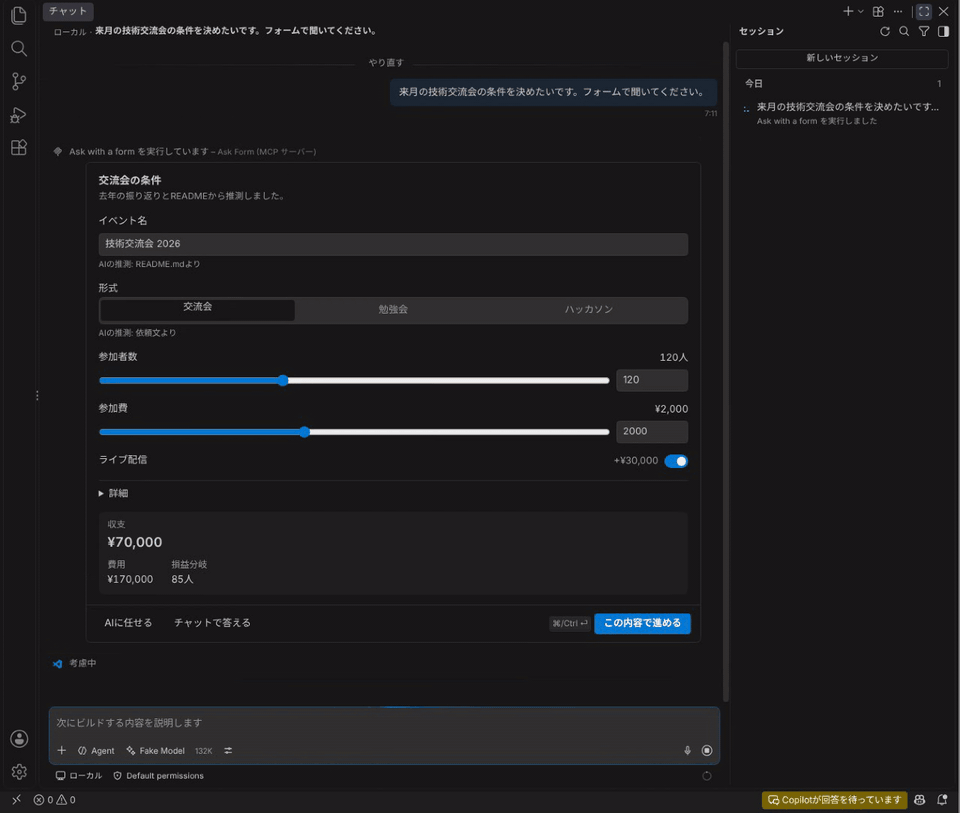
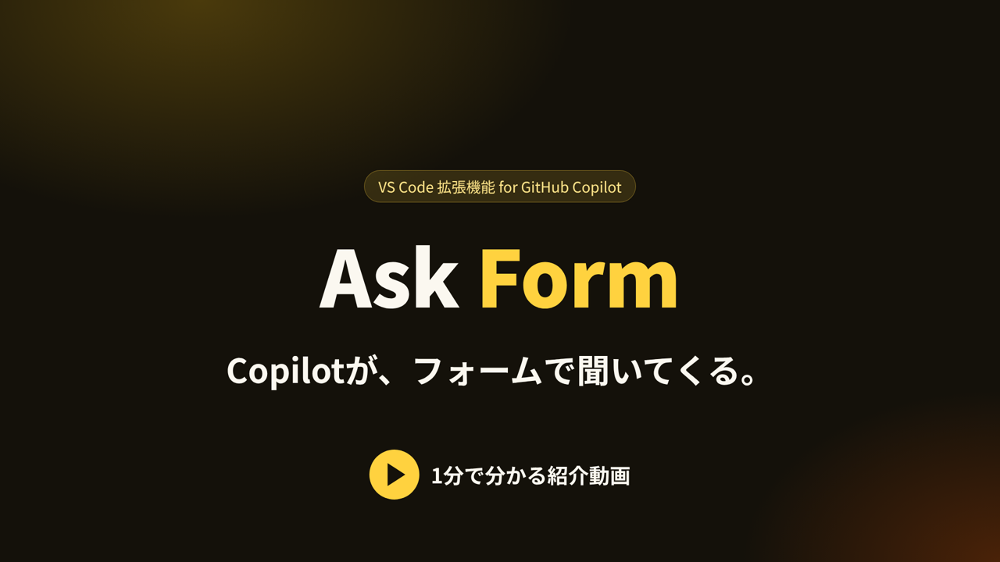
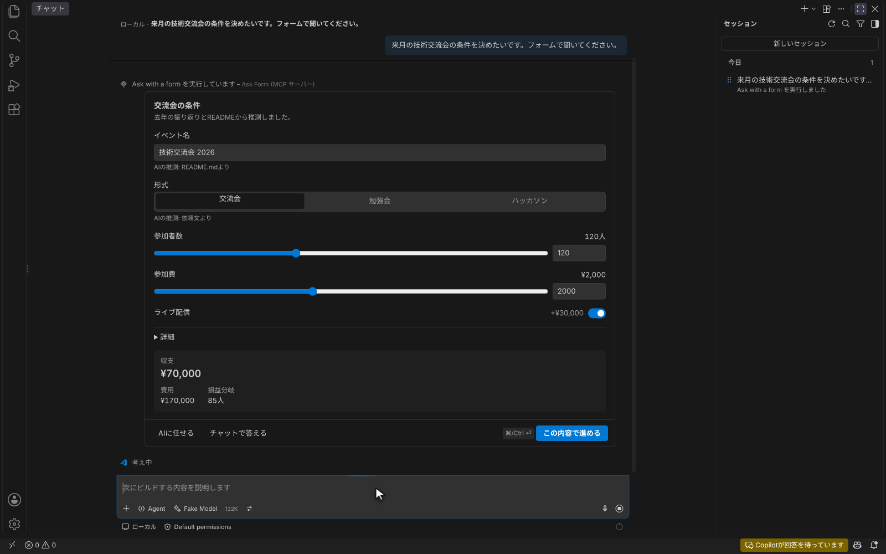
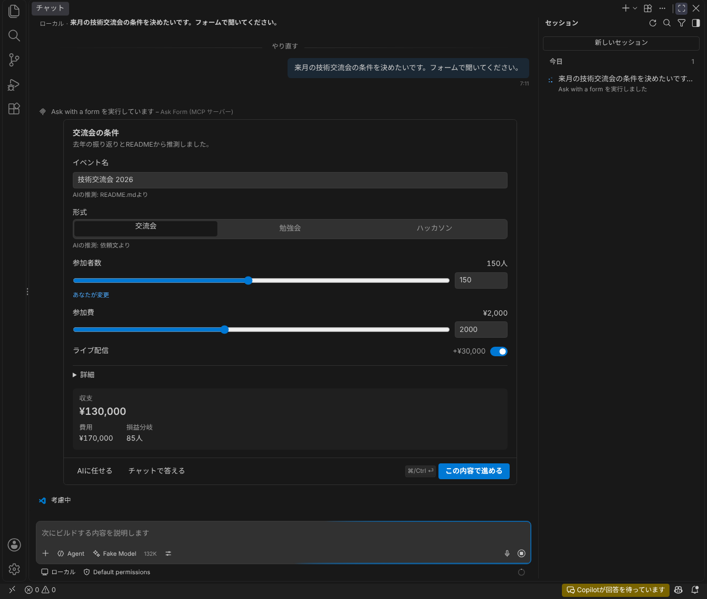
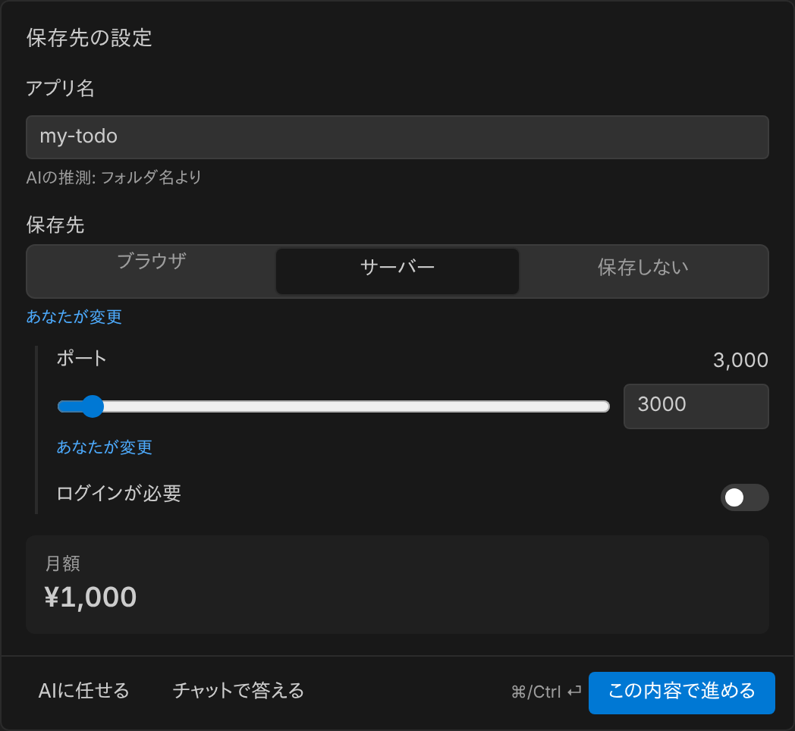
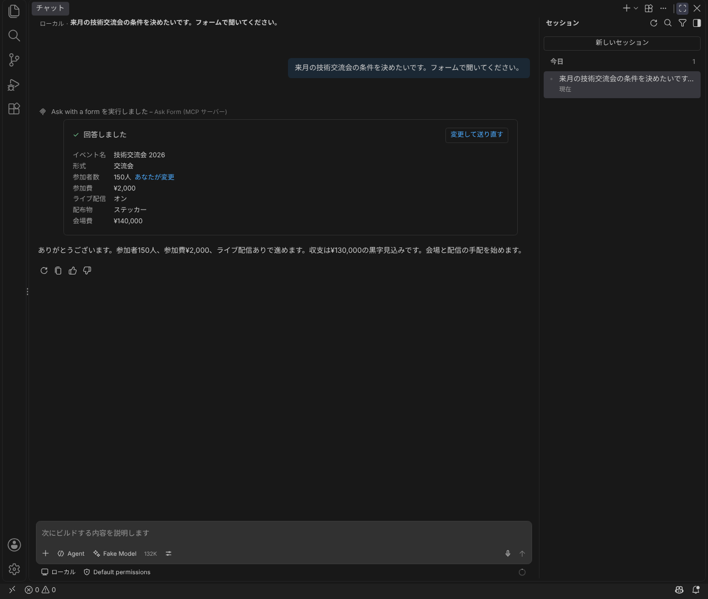
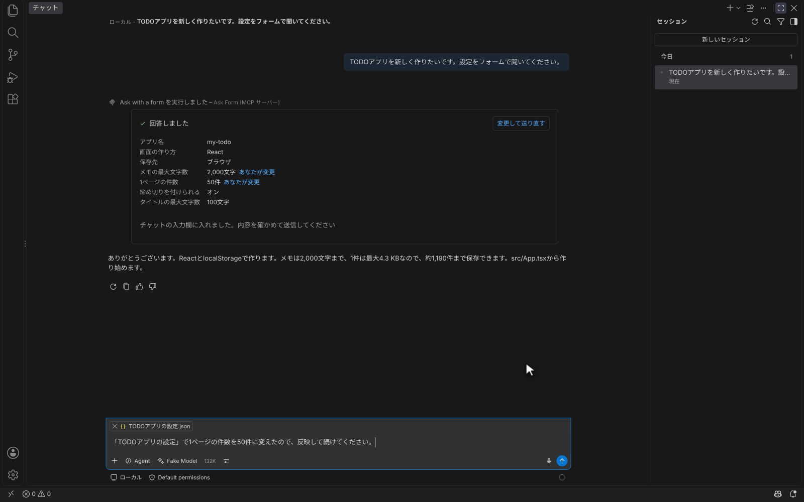

<h1 align="center">Ask Form</h1>

<p align="center">
  GitHub Copilotが、チャットの中のフォームであなたに質問できるようにするVS Codeの拡張機能
</p>

<p align="center">
  <a href="https://github.com/kkun84/vscode-ask-form/actions/workflows/ci.yml"></a>
  <a href="LICENSE"></a>
  
  
</p>

<p align="center">
  
</p>

<p align="center">
  <a href="docs/media/ask-form-pv.mp4"></a>
  <br>
  <a href="docs/media/ask-form-pv.mp4">▶ 1分で分かる紹介動画(MP4)</a>
</p>

Copilotは、仕事を進める途中で利用者に確認したいことがよくあります。項目が多い質問や、値どうしが連動する質問を文章でやり取りすると、何度も往復することになります。

Ask Formを入れると、Copilotはそうした質問を**フォームで**聞けます。フォームには最初から**Copilotの推測値と、その根拠**が入っています。利用者は違うところだけを直し、ボタンを1回押せば答えられます。Copilotは同じ作業の流れのまま、受け取った値で続きを進めます。

## 目次

- [特徴](#特徴)
- [スクリーンショット](#スクリーンショット)
- [動作環境](#動作環境)
- [インストール](#インストール)
- [使い方](#使い方)
- [フォームの設計図](#フォームの設計図)
- [しくみ](#しくみ)
- [よくある質問](#よくある質問)
- [開発](#開発)
- [ライセンス](#ライセンス)

## 特徴

- **推測値と根拠が入ったフォーム**: 各項目にはCopilotの推測値が入り、「AIの推測: フォルダ名より」のように根拠が添えられます。直した項目には「あなたが変更」と印が付き、Copilotにもどの項目を直したかが伝わります。
- **決める前に結果が分かる**: 選んだ値から計算される値を、フォームの中で示せます。たとえばメモの最大文字数を上げると、保存できる件数がどれだけ減るかがその場で分かります。
- **選んだ答えに応じて続きを聞ける**: 「保存先がサーバーならポート番号も聞く」のように、選択肢ごとに続きの項目を持たせられます。利用者には選んだ選択肢に関係する項目だけが見え、Copilotにも関係する値だけが届きます。
- **1回の操作で回答**: 「この内容で進める」を押すと、回答がそのままツールの結果としてCopilotに届きます。チャットに打ち直す必要はありません。
- **答え方を選べる**: 推測値のまま「AIに任せる」ことも、フォームを閉じて「チャットで答える」こともできます。
- **後から直して送り直せる**: 回答後のフォームは要約になります。「変更して送り直す」で値を直すと、差分を述べた文章と全項目の値のJSONが、そのフォームの会話の入力欄に入ります。
- **待っていることが分かる**: Copilotが回答を待っている間は、ステータスバーに「Copilotが回答を待っています」と表示されます。チャットを止めると、フォームも「キャンセルされました」に変わります。
- **デスクトップ版とweb版**: デスクトップ版ではチャットの中に、web版(vscode.dev)ではチャットの横のパネルにフォームを表示します。
- **VS Codeになじむ見た目**: 配色はVS Codeのテーマ(ライト、ダーク、ハイコントラスト)に合わせ、表示は日本語と英語に対応します。キーボードだけでも操作できます。

## スクリーンショット

### 推測値と根拠が入ったフォーム

Copilotはワークスペースや会話から値を推測し、根拠と一緒にフォームを出します。



### 決める前に結果が分かる

メモの最大文字数を100文字から5,000文字に直すと「あなたが変更」と印が付き、1件の最大サイズが0.6 KBから10.2 KBに、ブラウザに保存できる件数が8,533件から501件に変わります。



### 選んだ答えに応じて続きを聞く

保存先に「サーバー」を選ぶと、そのすぐ下にポート番号とログインの要否が現れます。「ブラウザ」なら保存方式だけを聞きます。回答には、選んだ保存先に関係する値だけが入ります。



### 回答すると、Copilotが同じ流れで続ける

「この設定で作る」を押すと、フォームは回答の要約になり、Copilotは受け取った値で作業を続けます。



### 後から直して送り直す

要約の「変更して送り直す」で1ページの件数を直して送ると、差分の文章と値のJSONがそのフォームの会話の入力欄に入ります。内容を確かめてEnterで送ります。



## 動作環境

- VS Code 1.110以降(デスクトップ版、またはvscode.devなどのweb版)
- GitHub Copilot Chat。ほかのモデルをBYOKでつないだ場合も使えます。
- エージェントのモード

## インストール

0.1.xはプレリリースです。GitHub Releasesでもpre-releaseの印が付きます。配布条件は[リリースの基準](docs/release.md)を参照してください。

### GitHub Releasesから

1. [Releases](https://github.com/kkun84/vscode-ask-form/releases)から`ask-form-<バージョン>.vsix`をダウンロードします。
2. VS Codeのコマンドパレットで「拡張機能: VSIX からのインストール...」を実行し、ダウンロードしたファイルを選びます。

コマンドラインからも入れられます。

```sh
code --install-extension ask-form-<バージョン>.vsix
```

### ソースから

```sh
git clone https://github.com/kkun84/vscode-ask-form.git
cd vscode-ask-form
nix develop
pnpm install
pnpm package
code --install-extension ask-form-*.vsix
```

## 使い方

1. チャットを開き、モードを「エージェント」にします。
2. ツールの一覧で「Ask Form」が有効になっていることを確かめます。
3. 確認が必要な作業を頼みます。Copilotが必要と判断したときにフォームが出ます。明示的に頼むこともできます。

たとえば、次のように頼みます。

```text
TODOアプリを新しく作りたいです。設定をフォームで聞いてください。
```

```text
このAPIのレート制限の設定を一緒に決めたい。候補の値と影響が分かるようにフォームで確認して。
```

フォームでは次の操作ができます。

| 操作                       | 結果                                                                         |
| -------------------------- | ---------------------------------------------------------------------------- |
| この内容で進める(Ctrl/⌘+⏎) | 入力した値がCopilotに届く。直した項目も伝わる                                |
| AIに任せる                 | 推測値のまま、判断をCopilotに任せる                                          |
| チャットで答える           | フォームを閉じ、チャットに文章で答える                                       |
| 変更して送り直す           | 回答後に値を直し、差分の文章と値のJSONを、そのフォームの会話の入力欄に入れる |

> [!NOTE]
> MCP Appsの表示には、設定`chat.mcp.apps.enabled`が有効である必要があります(既定で有効)。

### MCPが使えない環境、MCPを使いたくない場合

組織のポリシーでMCPが制限されたVS Code(`chat.mcp.access`が`all`でない)では、MCPサーバーを提供せず、拡張機能のツール`#askForm`で動きます。フォームはweb版と同じく、チャットの横のパネルに出ます。

MCPが使える環境でも、設定`askForm.mcp.enabled`を無効にすると、同じ方法に切り替わります。設定は再起動なしで反映されます。

> [!NOTE]
> 組織が許可リストなどでMCPサーバー個別に制限していて、`chat.mcp.access`が`all`のままの場合は、自動では切り替わりません。そのときは`askForm.mcp.enabled`を無効にしてください。

## フォームの設計図

Copilotは、次のようなJSONでフォームを指定します。利用者が書く必要はありませんが、Copilotに何を聞かせられるかの目安になります。

```json
{
  "title": "TODOアプリの設定",
  "description": "README.mdのメモから推測しました。",
  "fields": [
    { "type": "text", "id": "name", "label": "アプリ名", "default": "my-todo", "reason": "フォルダ名より" },
    {
      "type": "choice",
      "id": "framework",
      "label": "画面の作り方",
      "options": [
        { "value": "react", "label": "React" },
        { "value": "vue", "label": "Vue" },
        { "value": "svelte", "label": "Svelte" }
      ],
      "default": "react",
      "reason": "README.mdに「Reactで」とあるため"
    },
    {
      "type": "number",
      "id": "memoMax",
      "label": "メモの最大文字数",
      "default": 100,
      "min": 100,
      "max": 5000,
      "step": 100,
      "suffix": "文字"
    },
    { "type": "number", "id": "pageSize", "label": "1ページの件数", "default": 20, "min": 5, "max": 100, "step": 5, "suffix": "件" },
    { "type": "toggle", "id": "due", "label": "締め切りを付けられる", "default": true },
    {
      "type": "number",
      "id": "titleMax",
      "label": "タイトルの最大文字数",
      "default": 100,
      "min": 20,
      "max": 500,
      "step": 10,
      "suffix": "文字",
      "advanced": true
    }
  ],
  "computed": [
    {
      "id": "size",
      "label": "1件の最大サイズ",
      "expression": "round(((titleMax + memoMax) * 2 + 200) / 1024, 1)",
      "suffix": " KB",
      "decimals": 1
    },
    { "id": "capacity", "label": "ブラウザに保存できる件数", "expression": "floor(5120 / size)", "suffix": " 件", "primary": true }
  ],
  "submitLabel": "この設定で作る"
}
```

| 項目の種類 | できること                                                      |
| ---------- | --------------------------------------------------------------- |
| `text`     | 1行または複数行の文字列                                         |
| `number`   | スライダーと数値の入力。範囲、刻み、単位(`件`や`¥`)を指定できる |
| `choice`   | 選択肢。単一選択と複数選択                                      |
| `toggle`   | オンとオフ。費用などの補足を添えられる                          |

計算結果の式では、四則演算、比較、論理演算、条件式、`min` `max` `abs` `floor` `ceil` `round`を使えます。項目には`reason`(推測の根拠)と`advanced`(「詳細」の中に畳む)を付けられます。

単一選択の選択肢には`fields`を付けられます。その選択肢を選んだときだけ、`fields`の項目が選択肢のすぐ下に現れます。

```json
{
  "type": "choice",
  "id": "storage",
  "label": "保存先",
  "default": "browser",
  "options": [
    {
      "value": "browser",
      "label": "ブラウザ",
      "fields": [
        {
          "type": "choice",
          "id": "engine",
          "label": "保存方式",
          "options": [
            { "value": "local", "label": "localStorage" },
            { "value": "indexed", "label": "IndexedDB" }
          ]
        }
      ]
    },
    {
      "value": "server",
      "label": "サーバー",
      "fields": [{ "type": "number", "id": "port", "label": "ポート", "default": 8080, "min": 1, "max": 65535 }]
    },
    { "value": "none", "label": "保存しない" }
  ]
}
```

回答の`values`には、選んだ選択肢の`fields`の項目だけが入ります。たとえば「サーバー」なら`{ "storage": "server", "port": 8080 }`となり、`engine`は入りません。`fields`の中の選択項目に、さらに`fields`を付けることはできません。

すべてのキーと制約は[システム仕様](docs/spec/system.md#spec-form-001-設計図の形)にあります。

## しくみ

| 環境           | フォームの出る場所   | しくみ                                                                                                              |
| -------------- | -------------------- | ------------------------------------------------------------------------------------------------------------------- |
| デスクトップ版 | チャットの中         | 拡張機能が`127.0.0.1`でMCPサーバーを動かし、[MCP Apps](https://modelcontextprotocol.io)のツール`ask_form`を公開する |
| web版、MCPなし | チャットの横のパネル | 拡張機能のツール`forms_ask_form`(チャットでは`#askForm`)を登録し、Webviewのパネルに同じ画面を表示する               |

- MCPサーバーは起動ごとに作るトークンを持たない要求と、ブラウザからの要求を拒否します。
- ツールは読み取り専用で外の世界に触れないと宣言しているので、実行の前後に確認を求められません。
- 配布物が使う外部パッケージは[Effect](https://effect.website)だけです。

## よくある質問

<details>
<summary>送り直しは、なぜ自動で送信されないのですか？</summary>

VS Codeの拡張機能のAPIには、送り先の会話を指定してメッセージを送る手段がありません。自動で送ると、別の会話を開いていたときにそちらへ送られるおそれがあります。そのためAsk Formは、差分の文章と値のJSONを**フォームのある会話の入力欄**に入れるところまでにしています。送るかどうかは利用者が確かめて決めます。

</details>

<details>
<summary>フォームが出ません。</summary>

チャットのモードが「エージェント」か、ツールの一覧で「Ask Form」が有効か、設定`chat.mcp.apps.enabled`が有効か(MCPで使う場合)を確かめてください。Copilotがフォームを使う必要がないと判断することもあるので、「フォームで聞いて」と頼むと確実です。

</details>

<details>
<summary>パスワードなどの秘密も聞かれますか？</summary>

Copilotには、秘密や認証情報をフォームで聞かないように指示しています。

</details>

## 開発

配布の条件と手順は[リリースの基準](docs/release.md)にあります。

開発環境はnixで用意します。実機のVS Codeでの受け入れテストには、VS Codeを含む`nix develop .#acceptance`を使います。

```sh
nix develop
pnpm install
pnpm build
```

| コマンド               | 内容                                                                                                                    |
| ---------------------- | ----------------------------------------------------------------------------------------------------------------------- |
| `pnpm lint`            | oxlint、oxfmt、fallow(未使用のコード、重複、循環参照、層の境界、複雑さ)、markdownlint、コメントとトレーサビリティの検査 |
| `pnpm typecheck`       | TypeScript 7とEffectの診断による型検査                                                                                  |
| `pnpm test`            | 単体、結合、システム、画面のテスト                                                                                      |
| `pnpm test:acceptance` | 実際のVS Code(デスクトップ版、web版、チャット)での受け入れテスト                                                        |
| `pnpm media`           | 実際のVS CodeでREADMEの画像、GIF、紹介動画(`docs/images`、`docs/media`)を撮り直す                                       |
| `pnpm budget`          | 配布物の大きさの検査                                                                                                    |
| `pnpm traceability`    | `docs/traceability.md`の生成                                                                                            |
| `pnpm package`         | `.vsix`の作成                                                                                                           |

コミットの前に[lefthook](https://github.com/evilmartians/lefthook)が、変更したファイルの整形と、検査と単体テストを実行します(設定は`lefthook.yml`)。Linuxでは受け入れテストと`pnpm media`を`xvfb-run`の中で動かします。

### 実機での受け入れテスト

受け入れテストは、実際のVS CodeとビルトインのCopilot Chatを動かします。チャットのモデルには、決まった応答を返す偽のLLM APIをBYOK(Custom Endpoint)としてつなぎ、フォームの表示、回答、送り直し、中断までを通して確かめます。READMEの画像と動画も、同じしくみで撮っています。

### 文書とテストの対応

V字モデルに沿って、要求から設計までを段階ごとの文書に書き、各段階に対応するテストで検証します。

| 文書                          | ID     | 検証                                                |
| ----------------------------- | ------ | --------------------------------------------------- |
| `docs/spec/requirements.md`   | `REQ`  | 受け入れテスト(`test/acceptance`)、手動受け入れ手順 |
| `docs/spec/system.md`         | `SPEC` | システムテスト(`test/system`)                       |
| `docs/design/architecture.md` | `ARCH` | 結合テスト(`test/integration`)                      |
| `docs/design/detailed.md`     | `DES`  | 単体テスト(`test/unit`)                             |

テストの名前はIDで始めます。`scripts/traceability.ts`が、すべての項目に派生元と検証があることを確かめ、`docs/traceability.md`を作ります。

### 決まり

- ソースコードにコメントを書きません(`scripts/no-comments.ts`で検査します)。
- 依存は少なく保ちます。配布物が使う外部パッケージは`effect`だけです。
- テストの実行時間と配布物の大きさの上限は`budgets.json`にあります。

## ライセンス

[MIT](LICENSE)

紹介動画の効果音には、[Kenney](https://kenney.nl)のCC0の音源を使っています。出典は[`scripts/sounds/SOURCES.md`](scripts/sounds/SOURCES.md)にあります。
